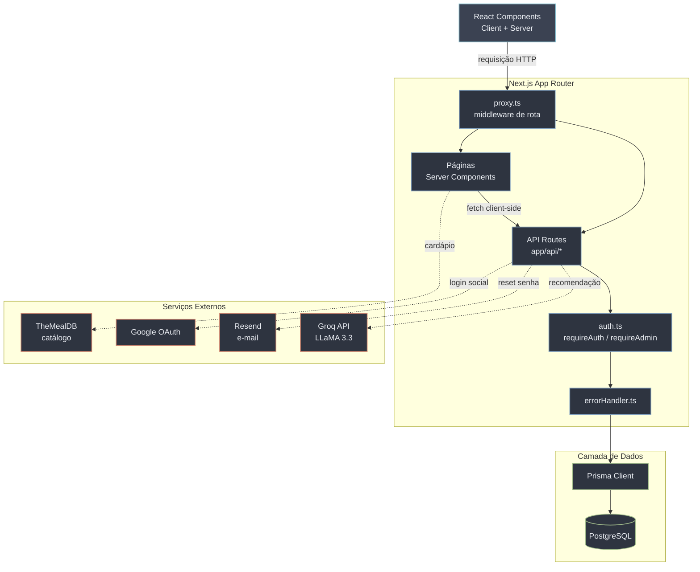
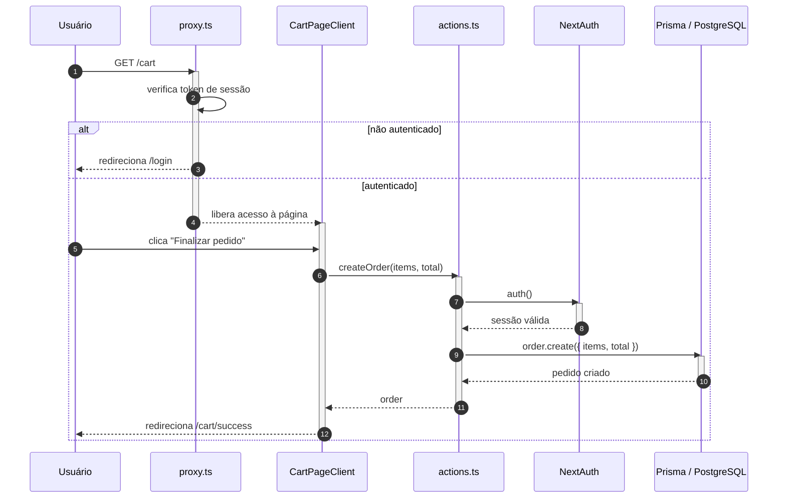
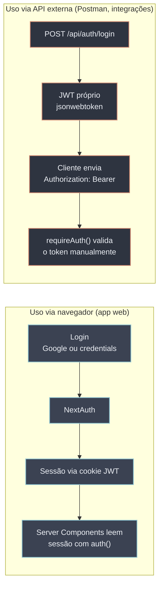

# Arquitetura do Sistema

## Visão geral

O FoodApp é uma aplicação **full-stack monolítica** construída sobre o **Next.js App Router**, que unifica front-end (React Server/Client Components) e back-end (API Routes) num único projeto e deploy. Não há separação física entre "frontend" e "backend" — ambos vivem em `src/app/`, diferenciados por convenção de pastas (`app/api/*` são rotas de API; o restante são páginas).



---

## Camadas

### 1. Middleware de rota (`src/proxy.ts`)

É o primeiro ponto de contato de toda requisição a rotas protegidas. Antes mesmo de a página ou API ser processada, o middleware lê o token de sessão (cookie do NextAuth) e decide:

- Bloqueia `/admin/*` para quem não tem `token.isAdmin`.
- Bloqueia `/cart` e `/profile` para quem não está autenticado.
- Redireciona usuário já logado para longe de `/login` e `/admin/login`.

Isso evita duplicar checagem de autenticação em cada página individualmente.

### 2. Páginas (Server Components)

A maioria das páginas (`page.tsx`) são **Server Components** — rodam no servidor, buscam dados diretamente (ex: `getCategories()`, `getMealById()`) e enviam HTML já pronto ao navegador. Componentes que precisam de interatividade (formulários, estado local, hooks) são marcados `'use client'` e ficam em arquivos `*Client.tsx` separados (padrão usado em `HomePage` → nenhum client necessário, mas em `AdminDashboardPage` → `AdminDashboardClient`, `ProfilePage` → `ProfilePageClient`).

### 3. API Routes (`src/app/api/*`)

Implementam a API REST consumida tanto pelo próprio front-end (via `fetch`) quanto por clientes externos (Postman, apps mobile futuros). Cada rota segue o mesmo padrão:

```
Request → requireAuth/requireAdmin (se protegida) → validação Zod → lógica de negócio (Prisma) → resposta padronizada
```

Erros lançados em qualquer ponto são capturados pelo `errorHandler` central e convertidos no formato padronizado de erro (ver `README.md`, seção "Tratamento de Erros").

### 4. Camada de dados (Prisma + PostgreSQL)

`lib/prisma.ts` exporta uma instância singleton do Prisma Client, evitando esgotar conexões em ambiente serverless (padrão recomendado pela própria Vercel/Next.js). O schema e as migrações vivem em `prisma/`.

### 5. Integrações externas

| Serviço                  | Uso                                                                                 | Onde                              |
| ------------------------ | ----------------------------------------------------------------------------------- | --------------------------------- |
| **TheMealDB**            | Fonte principal do catálogo de pratos (nome, imagem, ingredientes, modo de preparo) | `lib/api/mealdb.ts`               |
| **Google OAuth**         | Login social, via NextAuth                                                          | `lib/auth.ts`                     |
| **Resend**               | Envio do e-mail de recuperação de senha                                             | `lib/email.ts`                    |
| **Groq (LLaMA 3.3 70B)** | Motor do assistente de recomendação por chat                                        | `app/api/chat/recommend/route.ts` |

Essa decisão de arquitetura — **usar uma API pública de terceiros como fonte de catálogo em vez de manter todo o cardápio no banco próprio** — reduz o esforço de popular e manter dados de pratos, ao custo de depender da disponibilidade da TheMealDB e de tratar `mealId`s "fracos" (sem FK) no banco local, como documentado em [`modelo-de-dados.md`](./modelo-de-dados.md#por-que-meal-não-tem-fk).

---

## Fluxo de uma requisição autenticada (exemplo: criar pedido)



Esse fluxo usa **Server Actions** (`'use server'` em `cart/actions.ts`) em vez de uma API Route tradicional — uma escolha do Next.js App Router que permite chamar lógica de servidor diretamente de um Client Component sem precisar montar um endpoint REST manualmente. Já o checkout via API pública (Postman, integrações externas) usa as rotas REST convencionais em `app/api/orders`.

---

## Autenticação — dois mecanismos coexistindo

O sistema tem **duas estratégias de autenticação em paralelo**, cada uma servindo um propósito diferente:



Essa duplicidade existe porque o NextAuth gerencia sessão via cookies (ideal para o navegador, mas inacessível a um cliente REST externo), enquanto o JWT próprio permite que qualquer cliente HTTP (não só o navegador) se autentique contra a API. Ambos os fluxos, no fim, resolvem para o mesmo `User` no banco.

---

## Por que Next.js App Router (e não uma API separada)

Trade-offs considerados no projeto:

**A favor da abordagem monolítica adotada:**

- Um único deploy, um único pipeline de CI/CD
- Server Components eliminam boa parte do "loading spinner" tradicional (dados já vêm prontos no HTML)
- Compartilhamento de tipos TypeScript entre front e back sem duplicação

**Trade-off aceito:**

- Acoplamento maior entre UI e API — escalar o backend independentemente do frontend exigiria separar os dois no futuro
- API Routes do Next.js não são pensadas para altíssimo throughput como um serviço dedicado (Express/Fastify standalone) seria

---

## Ponto identificado para evolução futura: rotas duplicadas

Durante a documentação da API (Swagger/OpenAPI), foi identificado que existem **hoje duas rotas paralelas** cobrindo praticamente a mesma responsabilidade:

| Responsabilidade   | Rota "pública"/REST documentada | Rota efetivamente usada pela UI                              |
| ------------------ | ------------------------------- | ------------------------------------------------------------ |
| Pedidos do usuário | `GET /api/orders`               | `GET /api/user/orders`                                       |
| Perfil do usuário  | `GET`/`PUT /api/users/me`       | `PUT /api/user/profile` (única com suporte a troca de senha) |

**Causa provável:** evolução incremental do projeto — a rota `/api/user/*` foi criada e consumida diretamente pela interface, enquanto `/api/orders` e `/api/users/me` seguiram como a superfície de API REST "oficial", documentada desde o início.

**Por que não foi corrigido nesta entrega:** o projeto já tem 241 testes automatizados cobrindo o comportamento atual dessas rotas (Atividade 3, 97%+ de cobertura). Unificar as rotas agora exigiria também atualizar os componentes que as consomem (`OrdersTab.tsx`, `ProfilePageClient.tsx`, `ProfileTab.tsx`) e a suíte de testes correspondente — risco desnecessário numa fase de fechamento de entrega, com uma suíte já validada e estável.

**Próximo passo recomendado:** unificar em uma única rota por responsabilidade (provavelmente mantendo `/api/user/*`, já que é a que a UI realmente usa, e descontinuando `/api/orders`/`/api/users/me` ou redirecionando uma para a outra), acompanhado da atualização dos testes de integração correspondentes.
