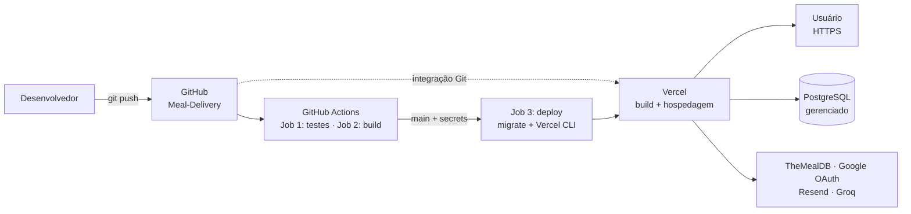

# Deploy da Aplicação

Este documento descreve como o FoodApp é publicado em produção.

**Aplicação publicada:** https://meal-delivery-eight.vercel.app

---

## 1. Visão geral



| Item                    | Escolha                                                                |
| ----------------------- | ---------------------------------------------------------------------- |
| Plataforma              | **Vercel** (plano Hobby, gratuito)                                     |
| Tipo de execução        | Serverless — páginas e rotas `app/api/*` viram Vercel Functions         |
| Front-end estático      | Vercel Edge Network (CDN global)                                       |
| Banco de dados          | **Supabase** (PostgreSQL gerenciado, plano gratuito)                   |
| Versionamento           | GitHub                                                                 |
| CI/CD                   | GitHub Actions (`.github/workflows/ci.yml`) + integração Git da Vercel |
| Certificado HTTPS       | Automático (Vercel)                                                    |

---

## 2. Como o deploy acontece

O projeto tem dois caminhos de deploy automatizado, que se complementam:

1. **Integração Git da Vercel (padrão).** O repositório está conectado ao projeto na Vercel. Todo `push` na `main` gera um deploy de **produção**; todo push em outra branch ou PR gera um **Preview Deployment** com URL própria, usado para validar antes do merge.
2. **Job 3 do GitHub Actions (`deploy`).** Roda apenas na `main`, **depois** que os testes (Job 1) e o build (Job 2) passaram. Ele:
   - aplica as migrações do Prisma no banco de produção (`prisma migrate deploy`), se o secret `PROD_DATABASE_URL` existir;
   - faz o build e o deploy de produção via Vercel CLI (`vercel pull` → `vercel build --prod` → `vercel deploy --prebuilt --prod`), se o secret `VERCEL_TOKEN` existir.

   Se os secrets não estiverem configurados, os passos são pulados com um aviso e o pipeline continua verde.

> Para que **só** código testado vá para produção, configure os secrets e desative o deploy automático da `main` na Vercel (**Project → Settings → Git → Ignored Build Step**). Assim o Job 3 passa a ser o único caminho até produção.

### Secrets do GitHub Actions

Em **Settings → Secrets and variables → Actions**:

| Secret              | Onde obter                                                    |
| ------------------- | ------------------------------------------------------------- |
| `VERCEL_TOKEN`      | vercel.com → Account Settings → Tokens                        |
| `VERCEL_ORG_ID`     | `.vercel/project.json` (gerado por `npx vercel link`)         |
| `VERCEL_PROJECT_ID` | `.vercel/project.json` (gerado por `npx vercel link`)         |
| `PROD_DATABASE_URL` | String de conexão (pooled) do banco de produção               |
| `PROD_DIRECT_URL`   | String de conexão direta (non-pooled) do banco de produção    |

---

## 3. Configuração do ambiente na Vercel

**Project → Settings → General**

| Configuração     | Valor                                     |
| ---------------- | ----------------------------------------- |
| Framework        | Next.js (detectado automaticamente)       |
| Build Command    | `npm run build` (`prisma generate && next build`) |
| Node.js          | 20.x                                      |
| Root Directory   | `./`                                      |

**Project → Settings → Environment Variables** (ambiente *Production*):

| Variável             | Obrigatória | Uso                                                        |
| -------------------- | ----------- | ---------------------------------------------------------- |
| `DATABASE_URL`       | Sim         | Conexão Prisma (pooled)                                    |
| `DIRECT_URL`         | Sim         | Conexão direta, usada pelas migrações                      |
| `AUTH_SECRET`        | Sim         | Assinatura da sessão NextAuth (`openssl rand -base64 32`)  |
| `JWT_SECRET`         | Sim         | Assinatura do JWT da API REST                              |
| `NEXTAUTH_URL`       | Sim         | `https://meal-delivery-eight.vercel.app`                   |
| `ADMIN_EMAILS`       | Sim         | E-mails com acesso ao painel admin, separados por vírgula  |
| `AUTH_GOOGLE_ID`     | Para login Google | OAuth Client ID (Google Cloud Console)               |
| `AUTH_GOOGLE_SECRET` | Para login Google | OAuth Client Secret                                  |
| `GROQ_API_KEY`       | Para o chat IA | Chave da Groq (assistente de recomendação)              |
| `RESEND_API_KEY`     | Para e-mail | Envio do e-mail de recuperação de senha                    |
| `EMAIL_FROM`         | Para e-mail | Remetente dos e-mails                                      |

> No Google Cloud Console, a URL de callback autorizada precisa incluir `https://meal-delivery-eight.vercel.app/api/auth/callback/google`.

Nenhum segredo fica no repositório: o `.gitignore` ignora todos os arquivos `.env*`.

---

## 4. Banco de dados em produção

O banco de produção é um **PostgreSQL gerenciado no Supabase** (plano gratuito). O catálogo de pratos vem da API pública TheMealDB, então a home funciona mesmo sem banco, mas **login, carrinho, pedidos, favoritos e painel admin dependem do PostgreSQL**.

| Variável na Vercel | Valor no Supabase (Project Settings → Database → Connection string) |
| ------------------ | ------------------------------------------------------------------- |
| `DATABASE_URL`     | *Transaction pooler* (porta 6543) com `?pgbouncer=true`              |
| `DIRECT_URL`       | Conexão direta / *Session pooler* (porta 5432), usada nas migrations |

Para aplicar o schema num banco novo (da máquina local):

```bash
DATABASE_URL="<pooler>" DIRECT_URL="<direta>" npx prisma migrate deploy
DATABASE_URL="<pooler>" DIRECT_URL="<direta>" npm run prisma:seed   # opcional: dados de demonstração
```

Depois, faça um *Redeploy* na Vercel se alguma variável tiver mudado.

### Pausa automática do plano gratuito

O Supabase gratuito **pausa o projeto após 7 dias sem atividade**; com o banco pausado, as rotas que usam o Prisma respondem `500`. Para evitar isso, o workflow `.github/workflows/keep-alive.yml` chama `GET /api/meals` (que consulta o banco) a cada 3 dias e falha se a API não responder `200`, servindo também como monitor simples de disponibilidade. Se o projeto pausar mesmo assim: Supabase → projeto → **Restore project**.

---

## 5. Checklist pós-deploy

- [ ] Home carrega o cardápio e as categorias
- [ ] Cadastro e login por e-mail/senha funcionam
- [ ] Login com Google funciona
- [ ] Adicionar ao carrinho → finalizar pedido → pedido aparece no perfil
- [ ] `/admin` acessível só para e-mails de `ADMIN_EMAILS`
- [ ] Admin altera status do pedido e o usuário vê a alteração
- [ ] `/api-docs` (Swagger) abre
- [ ] Pipeline verde na aba **Actions**

---

## 6. Rollback

Se um deploy quebrar produção: **Vercel → Deployments →** escolha o último deploy estável **→ ⋯ → Promote to Production** (ou *Instant Rollback*). A troca é imediata, sem novo build. Depois, corrija na `main` com um novo commit (ou `git revert`).
