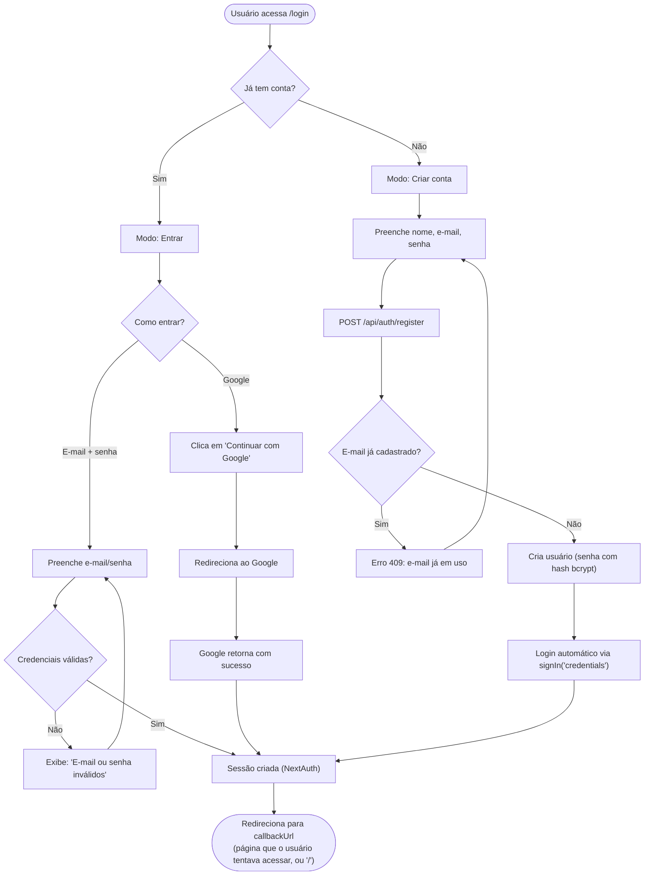
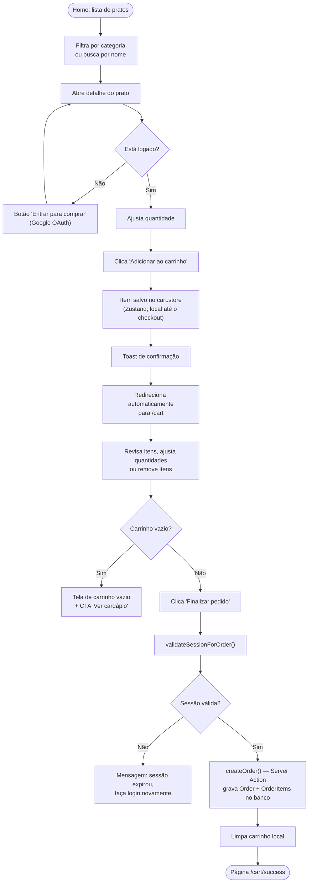
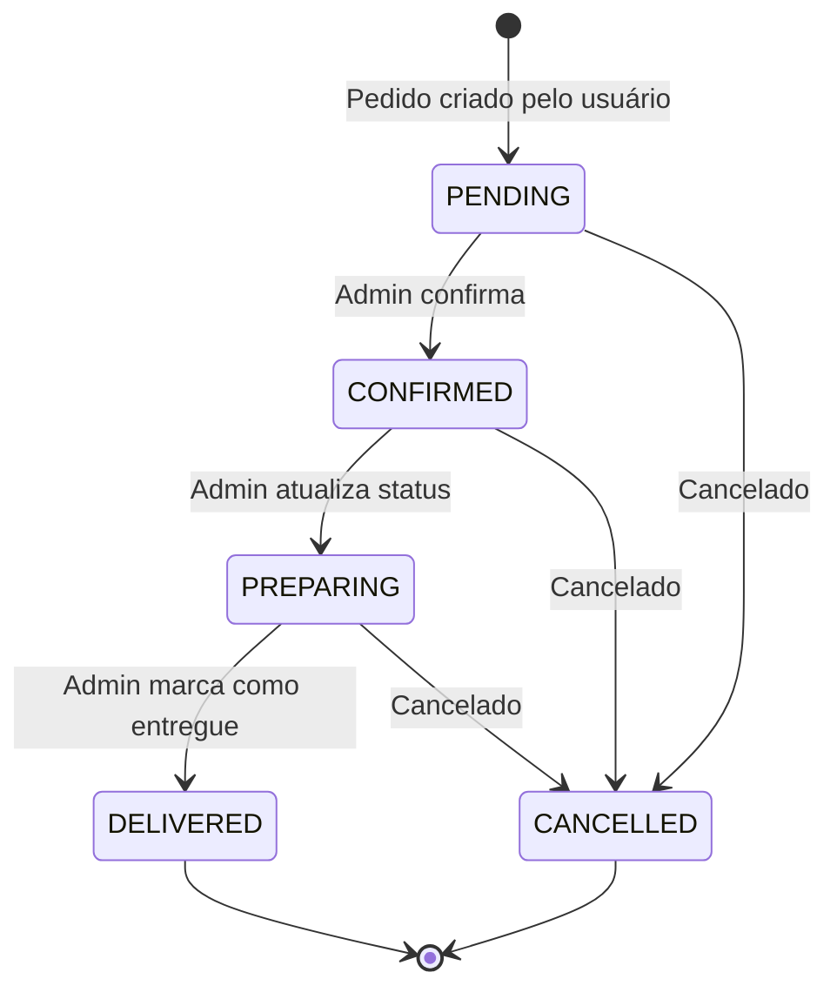
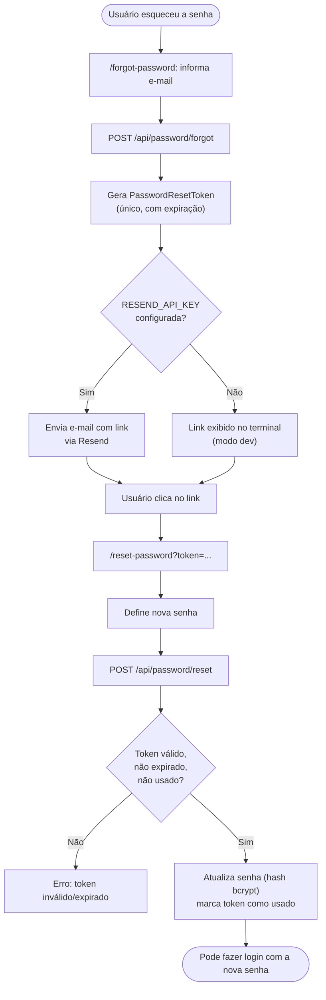
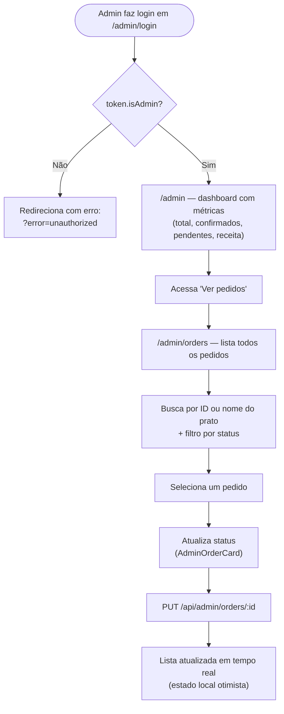

# Fluxos de Trabalho

Este documento descreve, em diagramas, os principais fluxos de uso do FoodApp — do ponto de vista do usuário e do administrador.

---

## 1. Login e Registro

O usuário pode entrar por dois caminhos independentes: e-mail/senha ou Google. Registrar-se automaticamente autentica o usuário em seguida.

**Observações:**

- Se o usuário tentava acessar uma rota protegida (ex: `/cart`) sem estar logado, o middleware (`proxy.ts`) o envia para `/login?callbackUrl=/cart` — após autenticar, ele volta exatamente pra onde queria ir.
- A senha, quando existe, é armazenada com hash bcrypt (custo 10) — nunca em texto puro.

---

## 2. Navegar → Adicionar ao Carrinho → Finalizar Pedido

**Observação de design:** o carrinho vive inteiramente no client (Zustand), sem persistência no banco até o momento do checkout. Isso significa que o carrinho **não sobrevive** a uma troca de dispositivo ou limpeza de cache antes de finalizar — um ponto a se considerar como próximo passo evolutivo (ver `README.md` / discussão de próximos passos na apresentação).

---

## 3. Ciclo de Vida do Pedido

- Todas as transições de status são feitas pelo **admin**, no painel `/admin/orders` (`AdminOrdersClient` → `AdminOrderCard`), via `PUT /api/orders/:id` ou `PUT /api/admin/orders/:id`.
- O usuário acompanha o status em `/profile?tab=orders`, mas não pode alterá-lo — apenas visualiza.
- Não há regra no banco impedindo "pular" estados (ex: ir de `PENDING` direto para `DELIVERED`); a validação de transição, se existir, é responsabilidade da camada de aplicação, não do schema.

---

## 4. Recuperação de Senha

---

## 5. Gerenciamento de Pedidos pelo Admin

