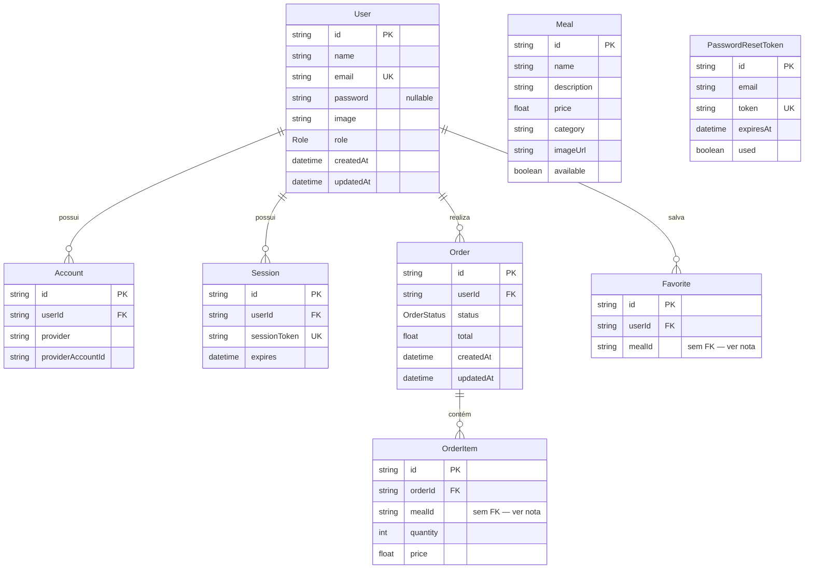

# Modelo de Dados

Este documento descreve o modelo de dados do FoodApp, baseado no schema Prisma (`prisma/schema.prisma`) e no PostgreSQL como banco relacional.

## Diagrama Entidade-Relacionamento



> `Meal` aparece no diagrama para referência, mas **não tem chave estrangeira** ligando `OrderItem.mealId` ou `Favorite.mealId` a ela — ver a seção [Por que `Meal` não tem FK](#por-que-meal-não-tem-fk) abaixo.

---

## Entidades

### `User`

Representa tanto usuários comuns quanto administradores — o papel é definido pelo campo `role` (`USER` | `ADMIN`), não por tabelas separadas.

- `password` é **opcional** (nullable): usuários que entram via Google OAuth nunca preenchem esse campo.
- `email` é único — é a chave de identificação entre os dois fluxos de login (credentials e Google), evitando contas duplicadas para o mesmo e-mail.
- Relaciona-se com `Account`/`Session` (tabelas exigidas pelo NextAuth) e com `Order`/`Favorite` (dados de negócio).

### `Account` e `Session`

Tabelas padrão exigidas pelo **NextAuth** para armazenar a ligação com provedores OAuth (Google) e as sessões ativas. Não são manipuladas diretamente pela aplicação — o NextAuth gerencia seu ciclo de vida.

### `VerificationToken`

Também exigida pelo NextAuth (fluxos de verificação/e-mail). Atualmente sem uso ativo na lógica de negócio do FoodApp.

### `PasswordResetToken`

Suporta o fluxo de "esqueci minha senha": um token único e com expiração (`expiresAt`) é gerado e enviado por e-mail. O campo `used` impede que o mesmo token seja reaproveitado após a troca de senha.

### `Meal`

Representa um prato do cardápio. **Na prática, o cardápio exibido no app vem da API pública TheMealDB** (via `lib/api/mealdb.ts`), com preço e disponibilidade próprios do FoodApp mesclados por cima. A tabela local `Meal` existe no schema, mas os relacionamentos de negócio (`OrderItem`, `Favorite`) não impõem integridade referencial contra ela.

### `Order` e `OrderItem`

Um pedido (`Order`) pertence a um `User` e contém uma ou mais linhas (`OrderItem`), cada uma referenciando um prato por `mealId` (string), quantidade e preço **no momento da compra** (`price` é copiado para o item, não recalculado a partir do prato — importante para o histórico não mudar se o preço do prato mudar depois).

- `Order.total` é o valor final do pedido, calculado no momento da criação (`cart/actions.ts`).
- `OrderItem` tem `onDelete: Cascade` a partir de `Order`: apagar um pedido remove seus itens junto.

### `Favorite`

Relação N:N simplificada entre usuário e prato, guardando apenas o `mealId`. A constraint `@@unique([userId, mealId])` garante que o mesmo prato não pode ser favoritado duas vezes pelo mesmo usuário.

---

## Enums

### `Role`

| Valor   | Significado                                       |
| ------- | ------------------------------------------------- |
| `USER`  | Usuário comum — acessa cardápio, carrinho, perfil |
| `ADMIN` | Acesso ao painel `/admin` — gerencia pedidos      |

### `OrderStatus`

```
PENDING → CONFIRMED → PREPARING → DELIVERED
                                 ↘ CANCELLED
```

| Valor       | Significado                                                   |
| ----------- | ------------------------------------------------------------- |
| `PENDING`   | Pedido criado, aguardando confirmação                         |
| `CONFIRMED` | Pedido confirmado pelo estabelecimento                        |
| `PREPARING` | Em preparo                                                    |
| `DELIVERED` | Entregue ao cliente                                           |
| `CANCELLED` | Cancelado (pode ocorrer a partir de qualquer estado anterior) |

---

## Por que `Meal` não tem FK

Duas migrations do projeto removem explicitamente as foreign keys entre `Meal` e as tabelas que a referenciam:

- `20260618221041_remove_meal_fk_from_favorites`
- `20260620162808_remove_meal_fk_from_order_items`

**Motivo:** o catálogo de pratos exibido no app é majoritariamente populado a partir da API externa **TheMealDB**, não apenas da tabela local `Meal`. Se `OrderItem.mealId` e `Favorite.mealId` exigissem uma FK estrita para a tabela local, seria impossível favoritar ou comprar um prato cujo `id` só existe na API externa. Removendo a FK, o `mealId` vira uma referência "fraca" (string livre), e a resolução dos dados do prato (nome, imagem, ingredientes) é feita em tempo de leitura via `getMealById()`, que busca tanto no banco local quanto na API externa.

**Trade-off:** ganha-se flexibilidade de catálogo (não depende só do banco local), mas perde-se integridade referencial no banco — um `mealId` "órfão" não gera erro no PostgreSQL, e a responsabilidade de tratar um prato que não existe mais fica na camada de aplicação (`item.meal ?? null` é tratado explicitamente nos componentes `OrdersTab` e `AdminOrdersClient`).

---

## Regras de negócio refletidas no schema

- Um usuário só pode favoritar o mesmo prato uma vez (`@@unique([userId, mealId])` em `Favorite`).
- Um e-mail só pode estar associado a uma conta (`@unique` em `User.email`), unificando login por senha e por Google.
- O preço de um item de pedido é congelado no momento da compra (`OrderItem.price`), preservando o histórico financeiro mesmo que o preço do prato mude depois.
- Apagar um pedido remove seus itens em cascata, mas apagar um usuário **não** remove seus pedidos automaticamente — não há `onDelete: Cascade` em `Order.user`, então a integridade do histórico de pedidos é preservada mesmo que a conta seja removida (o Prisma bloquearia a exclusão de um usuário com pedidos existentes, a menos que tratado explicitamente na aplicação).
